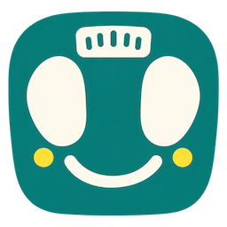
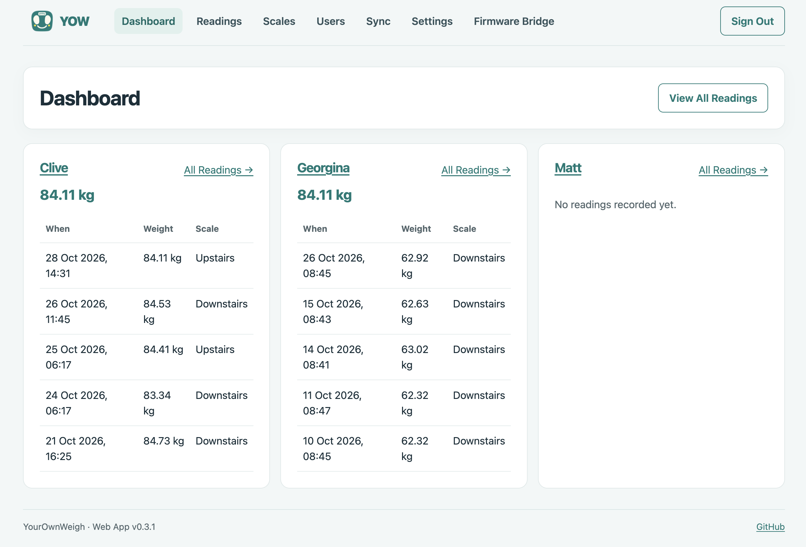

# YourOwnWeigh (YOW)
### _Free Wi-Fi Syncing for Withings Scales_

This project provides the components needed to have your Withings scales sync its readings to your own data store. The scales sync over wifi, as they do now, just for free and without Withings.

It is designed to allow you to ensure your hardware is able to work how you want, without subscription fees. You can sync to Apple Health, Google Health or anywhere you want.

If you want to know more about why, see this [blog post](https://www.tomanthony.co.uk/blog/withings-yow-free-wifi-sync/), otherwise there are quick start guides below - including how to host this all on a free CloudFlare account.

_This was just released 29th October, and whilst I'm using it fine on my own scales, I cannot make any guarantees._ Also this repo may be a bit rough around the edges, but I wanted to get _something_ out.

**If you are interested in helping as a maintainer, please email me at yow@&lt;domain-of-blog-post&gt;.** 

## YOW Components

This repo provides several components:

- firmware patches for various models (see below)
- a Python bridge app you run locally to do firmware updates
- a web app that
  - manages device config, users and readings
  - replaces Withings as the data sync API for your scales
  - acts as the firmware management interface (with the bridge)
- shortcuts/scripts that help you automatically sync this data (e.g. into Apple Health)

You can easily import your devices, and registered scale user roster into YOW, so you can continue right where you left off.



## Supported Models

The below models are currently supported. Pull Requests to add more models are very welcome.

| Scale | Stock Firmware | YOW Firmware | Bluetooth | Notes |
| --- | --- | --- | --- | --- |
| Body Smart (**WBS13**) | v1311 | v103 | BLE | |
| Body (**WBS06**) | v1181 | v127 | BLE | |
| Body Cardio (**WBS04**) | v2231 | v100 | BLE | Thx [KindOfNerdy](https://github.com/KindOfNerdy)! |
| Wireless Scale (**WS-30 / WBS03**) | v921 | v102 | Classic | Scales->YOW is HTTP only |
| Smart Body Analyzer (**WS-50 / WS50**) | v1721 | v1023 | Classic | HTTP only, experimental |

You can check your model under the batteries. Not all models with the same name (e.g. "Body Smart") are equivalent to one another, so please check the actual model number.

## Supported Platforms

| OS | Status |
| --- | --- |
| macOS 27 | Confirmed |
| macOS 26 | Should work |
| macOS 15 | Should work |
| Windows | Pending |
| Linux | Confirmed |

The web app component should support all operating systems, but the Python bridge currently only supports macOS & Linux. Windows support still needs adding.


## Quick Start Using Cloudflare

Using a free CloudFlare account, you can set this up end to end in a durable fashion.

You will deploy a CloudFlare worker that uses D1 for storage, and which serves as the YOW dashboard, the API for scales to speak to, and the Sync API for reading data back out (to Apple Health, for example).

You will also need to run the Python bridge on a machine that is within Bluetooth range of your scales.

1. Setup a free Cloudflare account (or use an existing account).
2. Run:

```sh
npm ci
npx wrangler login
npm run setup:cloudflare -- --name YOUR-SHORT-WORKER-NAME --deploy
```

_Choose a short Worker name_: the complete hostname must fit your scale's character limit below.

3. Open the HTTPS URL printed by Wrangler. Enter the bootstrap token, then set an admin password. The Sync API (for reading data out of YOW) uses it too, by default (you can override).
4. Install and start the Python bridge:

   ```sh
   python3.11 -m venv .venv
   .venv/bin/pip install ./bridge
   .venv/bin/yow-bridge
   ```

It will ask for an invite code, required for it to establish a secure connection to your server.

5. In the web app, open **Firmware Bridge**, and click **Generate Connection Invitation** and paste it into Terminal. Grant Bluetooth permissions if requested. The bridge's connected status appears in the page.
6. Put the scale into setup mode with its button. Press **Scan BLE** (or **Scan Classic** for older devices), and wait for that to complete.
7. Click **Connect** against the desired device, the bridge should  identify the scale automatically.
8. Accept **Import Device To Server**. The scales' existing settings are fetched automatically from Withings (using the MAC & Secret read from the device).
9. Users are also read from Withings, and new users can be imported too. (If the initial profile fetch fails, use **Finish Device Import** under **Scales → Edit Settings** later.)

At this point you now have your server running, with your device imported, and your user roster imported. We now need to update the firmware on your device so it also connects to this server - **only do this on supported devices (and accept it may be a risk)**.

10. Press **Generate Firmware**, which will download the supported Withing's firmware version for your scales and patch it with the necessary updates.
11. Make sure to review the model/version, then **Send Update To Device** and type `FLASH`. Keep the scale powered and bridge running.
12. After reboot reconnect to confirm the version. (Note: I sometimes found I had to remove the batteries and replace them after an update - something for the TODO list.)
13. Once reconnected, in the **Configure** pane, enter your  server's hostname (there is a link to help), and select the protocol the scales should use (some only support HTTP currently - your secret is hashed, but your data is in the clear).
14. Also update your Wifi details if needed.
15. Weigh yourself! Wait a moment (usually 20-40 seconds) and check **Readings**. Hopefully you have a result there!

## Running Locally with Caddy

You can run the whole server locally, but you will need your server to stay using the same internal network IP and to stay up. You can run locally just for getting up and running, and later import the database (via the Settings panel in the app) into another instance.

The firmware only supports connecting to ports 80 or 443, which a normal user cannot listen on, so install [Caddy](https://caddyserver.com/docs/install) which handles this for you.

Then run:

```sh
npm ci
npm run setup:local -- --scale-host YOUR_MAC_LAN_IP
```

- Open `http://127.0.0.1:8080`, use the printed bootstrap token and set your password.
- In a second Terminal, run the Caddy command printed by setup. It forwards HTTP 80 and HTTPS 443 to the **scale-only** listener at `127.0.0.1:8081`; the admin page remains on loopback. 
- You can now follow from step 4 (Python bridge) in the CloudFlare section above, entering the machines IP as the scale's hostname. 

## FAQ

**Q)** Will this brick my device?

Unlikely, but possible. I flashed lots of firmware attempts to my WBS06 and WS-30 scales whilst researching how to make this work, and that worked fine. I later added WBS13 without problems, and others have added more models without any reported issues.

The models I looked at all have two firmware slots, and updates are always written to the slot with the lowest version. I have deliberately set my version numbers low so one slot should retain a Withings vanilla firmware.

An incomplete firmware write (an interrupted one for example) invalidates a slot, and future updates will prefer an invalid slot, so you can try again.

There is a possibility that a bad firmware write makes your Bluetooth become unavailable in an unlucky, which would require rescuing your scales with a UART connection ($10 for a cable on Amazon) - there are various UART tools included in this repo for those who know what they are doing.

**Q)** Are you distributing Withings' firmware?

No - the app downloads the firmware from Withings' servers and then patched.

**Q)** How can I be sure my scales are on the YOW firmware?

Scanning and connecting via the app will show you a firmware version.

Or, remove a battery for a moment, and replace it. Stock firmware displays a 'Hello' message, but YOW firmware will show a smiley face.


**Q)** Why did you make this?

See this [blog post](https://www.tomanthony.co.uk/blog/withings-yow-free-wifi-sync/) for details, but mainly because syncing my scales was much buggier than it used to be, and Withings starting to charge people for it made me scared they'd charge everyone at somepoint.

**Q)** How can I help?

There are 3 areas that can help (all are achievable without special equipment):

 1. Adding Windows support to the Python bridge - most of the code should be transferrable but I don't have the hardware to check things.
 2. Adding support for more models of scales. You must own the model of scales you are adding, and be willing to test against them. You need to be comfortable with modding firmware, or trust AI to do it for you, and be willing to then install that on your own device.
 3. If you can't contribute firmware, but do own a model of scales (check under the batteries for the model number) not on the [firmware list](CONTRIBUTING.md), then running a Python script can identify the firmware used for that model, which is also useful.

See[CONTRIBUTING.md](CONTRIBUTING.md).

**Q)** Why have you not covered XYZ?

I'm time poor, doing this for fun in my spare time, and wanted to actually release _something_ without sinking loads more hours into it. It works for me as it is, and I'm hoping others can help fill in the gaps.

## Constraints And Current Limits

- The firmware currently supports hostnames over a limited length. WBS06 is max 48 chars. WS-30 is  59 chars.
- WBS06 HTTPS encrypts traffic but does not authenticate the server certificate or `CertificateVerify` signature. WS-30 uses plaintext HTTP. The bridge, browser and Withings migration client use ordinary verified HTTPS for remote services.
- Save original firmware/device backups and a recovery plan before OTA. Bluetooth does not read full firmware or expose/control the destination bank. An inactive bank can still supply radio resources; do not erase it casually. [UART recovery tools](tools/README.md).

## Related Projects

There are a few other community projects that relate to this

- [withings-local](https://github.com/pierosavi/withings-local) - supports syncing Withings scales to Homekit over Bluetooth. Doesn't require updating the firmware.
- [esphome-withings-wpp](https://github.com/NavistAuLabs/esphome-withings-wpp) - allows syncing Withings scales via an ESPHome sensor. Doesn't require updating the firmware.
- [openScale](https://github.com/oliexdev/openScale) - Open-source weight and body metrics tracker, with support for Bluetooth scales, but no Withings support currently.

## Legal

Withings is a trademark of Withings SA. This project is not affiliated with, endorsed by or supported by Withings. Use it at your own risk.
