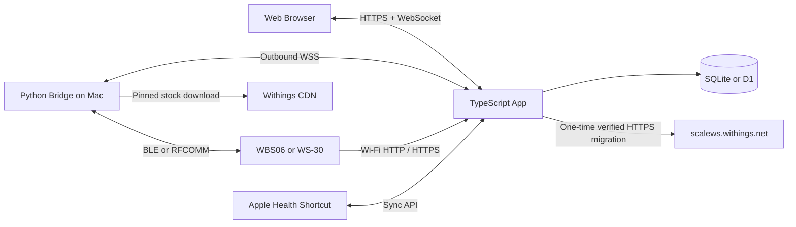

# Architecture

The browser uses model-neutral commands. Python owns protocol framing, radio callbacks, local firmware artifacts and OTA. The server owns authentication, data, user migration and timezone math. Node's `ws` adapter and Cloudflare's Durable Object use the same broker. The server never compiles or persists firmware images.

Daily weigh-ins need only the scale and server. A household has one admin password and one Sync API password (shared by default). Device secrets remain per scale. Imported numeric IDs identify users; no cross-account identity mapping layer is needed. Backups stage and commit in one transaction/batch against the existing schema.

Adding a platform means adding a Python transport. Adding a scale model also needs identity/capability rules, firmware recipe and server protocol behavior. Adding a health service means adding a client of the Sync API. These changes do not require duplicating the web application.
